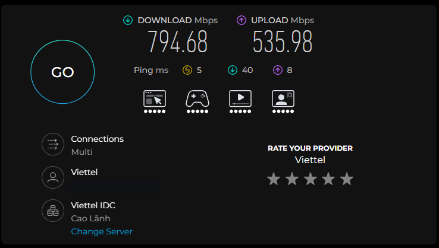
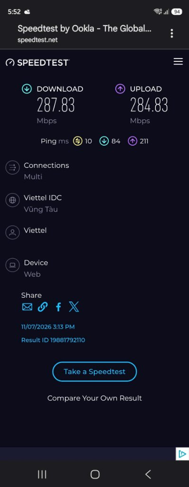
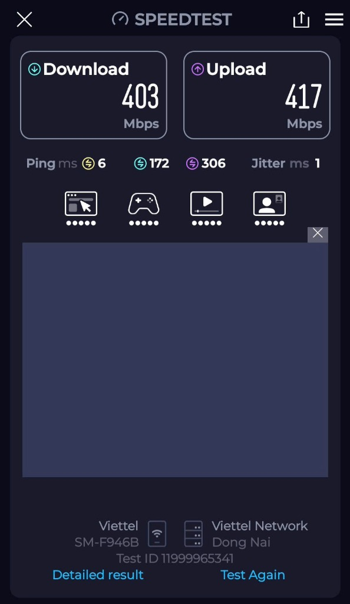

<div align="center">

# Agentic Workstation Optimizer

**Bộ công cụ tối ưu Phần cứng, Phần mềm, Mạng, Gaming, Automation Test & AI cho Windows 10/11**

[](https://github.com/AlexDo96/agentic-workstation-optimizer/releases)
[](./LICENSE)
[](https://github.com/AlexDo96/agentic-workstation-optimizer)
[](https://github.com/AlexDo96/agentic-workstation-optimizer)
[](https://github.com/AlexDo96/agentic-workstation-optimizer)

[Read in English](./README.md) | **Tiếng Việt**

[Lý do xây dựng](#lý-do-mình-tạo-bộ-công-cụ-này) •
[Cài đặt nhanh](#cài-đặt-nhanh) •
[Các hạng mục tối ưu](#các-hạng-mục-tối-ưu) •
[Chạy bằng PowerShell](#cách-chạy-trực-tiếp-bằng-powershell) •
[Kết quả & Bằng chứng](#kết-quả-thử-nghiệm-thực-tế--bằng-chứng-evidence) •
[Cấu trúc thư mục](#cấu-trúc-thư-mục) •
[Giấy phép](#giấy-phép-license)

</div>

---

## Tổng quan

`agentic-workstation-optimizer` là bộ script PowerShell kết hợp định nghĩa Skill/Subagent cho các công cụ lập trình AI (**Google Antigravity**, **Claude Code**, **OpenCode**, **Cursor**, **OpenAI Codex CLI**, **Windsurf**, **GitHub Copilot**), giúp kiểm tra và xử lý các điểm nghẽn hiệu năng phổ biến trên máy tính Windows:

- **Tối ưu Phần cứng & Hệ điều hành:** Mở khóa chế độ nguồn `Ultimate Performance`, tinh chỉnh bộ lập lịch nhân CPU (`Win32PrioritySeparation = 38`), gộp các tiến trình `svchost.exe` bị phân mảnh trên RAM, thu hồi bộ nhớ vật lý từ các ứng dụng nền (`EmptyWorkingSet`), bật lập lịch GPU bằng phần cứng (`HAGS`) & `DirectX Windowed Flip Model`, và giảm tải đọc/ghi ổ cứng SSD/NTFS (`LastAccess`, `8.3`).
- **Mở khóa Tốc độ mạng & Giảm độ trễ (Ping):** Gỡ bỏ giới hạn 10 gói tin/ms mặc định của Windows (`NetworkThrottlingIndex`), nâng bộ đệm phần cứng `Receive/Transmit Buffers` của card mạng (`256/512` -> `2048`), tắt các chế độ tự ngủ tiết kiệm điện của cổng LAN (`EEE`, `ULP`, `ITR`), và tắt cơ chế gom gói chờ 200ms (`TCPNoDelay = 1`).
- **Tối ưu kết nối Cloud AI trên mạng công ty:** Xử lý tình trạng gọi API AI bị trễ hoặc lỗi chứng chỉ SSL trên mạng văn phòng bằng cách ưu tiên IPv4 cho Node.js (`--dns-result-order=ipv4first`), cấu hình Git và Node.js tin cậy kho chứng chỉ Windows (`schannel` / `NODE_USE_SYSTEM_CA=1`), và kiểm tra ngưỡng gói tin MTU khi bật VPN.
- **Hỗ trợ chạy Automation Test song song & AI cục bộ:** Mở rộng dải cổng mạng tạm thời từ `16.384` lên `55.535` cổng (`MaxUserPort = 65534`, `TIME_WAIT = 30s`) cho Playwright/Appium/API test, cấu hình mạng `Mirrored` cho WSL2/Docker, và bật Flash Attention + nén bộ nhớ KV cache 8-bit cho Ollama.
- **An toàn cho cả Máy ở nhà (`-Mode All`) và Máy công ty (`-Mode Work`):** Tự động sao lưu toàn bộ cấu hình gốc vào `backups/latest-snapshot.json` trước khi thay đổi và hỗ trợ khôi phục nguyên trạng bằng 1 lệnh.

---

## Lý do mình tạo bộ công cụ này

Mặc định trên Windows 10 và Windows 11, nhiều thiết lập về quản lý xung nhịp CPU, phân bổ RAM, đọc/ghi ổ cứng SSD và driver card mạng được đặt ở mức tiết kiệm điện hoặc giữ tương thích cũ, làm máy chưa phát huy hết hiệu năng phần cứng:

1. **Nghẽn phần cứng và phần mềm nền:** Chế độ nguồn mặc định (`Balanced`) thường hạ xung nhịp CPU hoặc bóp hiệu năng các tiến trình biên dịch/Docker chạy nền; Windows tách `svchost.exe` thành hàng chục tiến trình nhỏ gây tốn RAM; ổ cứng NTFS phải ghi lại thời gian truy cập (`LastAccess`) và tạo tên file ngắn kiểu cũ (`8.3`) mỗi khi quét qua hàng chục nghìn file trong `node_modules` hay `.venv`; tính năng tự quay màn hình ngầm (`GameDVR`) và tải cập nhật ngang hàng (`Windows Update P2P`) làm giảm FPS và gây giật ping khi đang chơi game hoặc họp trực tuyến.
2. **Nghẽn tốc độ mạng trên đường truyền cáp quang nhanh:** Giới hạn 10 gói tin mỗi mili-giây (`NetworkThrottlingIndex`), bộ đệm nhận/truyền của card mạng nhỏ (`256/512`), cùng các chế độ tự ngủ của cổng LAN (`EEE`/`ULP`) khiến đường truyền 700–1000 Mbps nhiều khi chỉ nhận được khoảng 200–250 Mbps trên máy tính.
3. **Gọi API AI bị chậm hoặc lỗi chứng chỉ trên mạng công ty:** Mạng công ty thường bật IPv6 nội bộ nhưng không có đường ra quốc tế (làm Node.js phải chờ hết thời gian chờ IPv6 rồi mới chuyển sang IPv4, gây trễ 0.5 – 1.5 giây mỗi lần gọi lệnh) hoặc dùng tường lửa kiểm tra SSL (Zscaler, Fortinet) làm Git và Node.js báo lỗi chứng chỉ.
4. **Đang nhận phản hồi dài từ AI thì bị đứng:** Khi bật VPN công ty, kích thước gói tin tối đa (MTU) bị nhỏ lại. Nếu gói tin lớn bị rớt, luồng chữ trả về từ Claude/OpenAI sẽ bị treo giữa chừng.
5. **Chạy nhiều bài test song song bị hết cổng kết nối:** Windows mặc định chỉ mở khoảng 16.000 cổng mạng tạm thời và giữ cổng chờ đóng tới 120 giây. Khi chạy Playwright E2E nhiều luồng hoặc bắn API test liên tục, máy rất dễ bị báo lỗi kết nối.
6. **WSL2 và Docker bị mất mạng khi bật VPN công ty** hoặc ngốn nhiều RAM không tự trả lại cho Windows, cộng thêm các tiến trình `chromedriver` hoặc model AI trên Ollama vẫn chiếm dụng RAM/VRAM sau khi đã dùng xong.

---

## Cài đặt nhanh

### Cài đặt tự động vào tất cả AI Agent trên máy

Yêu cầu: Windows 10/11 và PowerShell.

```powershell
git clone https://github.com/AlexDo96/agentic-workstation-optimizer.git
cd agentic-workstation-optimizer
powershell -ExecutionPolicy Bypass -File .\install.ps1
```

### Cách gọi trong từng công cụ AI / IDE

| Công cụ AI / IDE | Cách sử dụng | Thư mục được cài đặt |
| :--- | :--- | :--- |
| **Claude Code CLI** | Gõ `/agentic-workstation-optimizer` hoặc gọi `@network-doctor` | `~/.claude/skills/`, `~/.claude/commands/`, `~/.claude/agents/` |
| **OpenCode CLI** | Gõ `/agentic-workstation-optimizer` hoặc gọi `network-doctor` | `~/.config/opencode/skills/`, `~/.config/opencode/commands/`, `~/.config/opencode/agent/` |
| **Google Antigravity** | Nhắn AI dùng skill `agentic-workstation-optimizer` hoặc `network-doctor` | `~/.gemini/config/skills/`, `~/.gemini/config/agents/` |
| **OpenAI Codex CLI** | Nhắn Codex chạy skill `agentic-workstation-optimizer` | `~/.codex/skills/` |
| **Cursor IDE** | Gõ `@agentic-workstation-optimizer` trong khung chat | `.cursor/rules/agentic-workstation-optimizer.mdc` |
| **Windsurf / Copilot** | Mở thư mục dự án, AI tự đọc hướng dẫn trong `AGENTS.md` | `AGENTS.md`, `.agents/skills/` |

---

## Các hạng mục tối ưu

| Nhóm hạng mục | Chi tiết thiết lập áp dụng | Chế độ (`-Mode`) |
| :--- | :--- | :--- |
| **CPU & Quản lý nguồn** | Mở khóa chế độ nguồn `Ultimate Performance` (giữ xung nhịp AC Min/Max `100%`), đặt `Win32PrioritySeparation = 38` (`0x26`), tắt bóp xung tiến trình nền (`PowerThrottlingOff = 1`). | `All`, `Work`, `Gaming` |
| **GPU & Hiệu năng Gaming** | Bật GPU HAGS (`HwSchMode = 2`), `DirectX Windowed Flip Model` (`SwapEffectUpgradeEnable=1;`), `Auto Game Mode`, tắt quay màn hình ngầm `GameDVR`, đặt ưu tiên `MMCSS Tasks\Games` (`GPU Priority = 8`, `Priority = 6`). | `All`, `Gaming` (`HAGS` có trong `Work`) |
| **RAM & Bộ nhớ vật lý** | Đặt `SvcHostSplitThresholdInKB` theo tổng dung lượng RAM để gộp các tiến trình `svchost.exe`; gọi hàm Win32 `EmptyWorkingSet` (`psapi.dll`) thu hồi RAM trống từ các tiến trình nền. | `All`, `Work`, `Gaming` |
| **Ổ cứng SSD & NTFS** | Bật `LongPathsEnabled = 1`, tắt cập nhật thời gian truy cập file (`disablelastaccess = 1`), tắt tạo tên file ngắn kiểu cũ (`8dot3name set 1`), đảm bảo bật lệnh `TRIM` cho SSD. | `All`, `Work`, `Gaming` |
| **Phần mềm & Giao diện Windows** | Giảm trễ menu xuống `MenuShowDelay = 10` ms, tắt đánh thức ngầm ứng dụng Store (`GlobalUserDisabled = 1`), tắt upload P2P của Windows Update (`DODownloadMode = 0`), dọn `%TEMP%`. | `All`, `Work`, `Gaming` |
| **Tốc độ mạng & Card LAN** | Đặt `NetworkThrottlingIndex = 0xffffffff`, `SystemResponsiveness = 0`, `NonBestEffortLimit = 0`, nâng `Receive/Transmit Buffers = 2048`, tắt `EEE`/`ULP`/`ITR`, bật `TCPNoDelay = 1`. | `All`, `Work`, `Gaming` |
| **Mạng công ty & Cloud AI** | Đặt `NODE_OPTIONS=--dns-result-order=ipv4first`, `NODE_USE_SYSTEM_CA=1`, `git http.sslBackend=schannel`, đo ngưỡng MTU qua VPN *(không đụng vào DNS, AD hay VPN công ty)*. | `All`, `Work` |
| **Automation Test & Công cụ Dev** | Mở rộng lên `55.535` cổng tạm thời (`MaxUserPort = 65534`), giảm `TcpTimedWaitDelay = 30s`, đặt `git http.postBuffer = 500MB`, `UV_HTTP_TIMEOUT = 120s`. | `All`, `Work` |
| **AI cục bộ (Ollama) & WSL2** | Đặt `OLLAMA_FLASH_ATTENTION = 1`, `OLLAMA_KV_CACHE_TYPE = q8_0`, tắt model Ollama treo trong VRAM, đóng WebDriver kẹt ngầm, cấu hình `.wslconfig` (`networkingMode=mirrored`, `autoMemoryReclaim=gradual`). | `All`, `Work` |

---

## Cách chạy trực tiếp bằng PowerShell

Bạn có thể mở **PowerShell (với quyền Administrator)** và chạy trực tiếp theo nhu cầu sử dụng (ở nhà hoặc trên công ty):

```powershell
# 1. Kiểm tra toàn bộ phần cứng, phần mềm, mạng, độ trễ API AI và xuất báo cáo ra file BENCHMARK_REPORT.md
powershell -ExecutionPolicy Bypass -File .\scripts\diagnose-network-ai.ps1 -SaveReport

# 2A. Tối ưu toàn diện cho MÁY Ở NHÀ (Tất cả: Phần cứng, Phần mềm, Gaming, Mạng & AI)
powershell -ExecutionPolicy Bypass -File .\scripts\optimize-workstation.ps1 -Mode All

# 2B. Tối ưu cho MÁY CÔNG TY (Chỉ tối ưu Phần cứng, Phần mềm, Mạng công ty, Test & AI; bỏ qua tinh chỉnh Game)
powershell -ExecutionPolicy Bypass -File .\scripts\optimize-workstation.ps1 -Mode Work

# 2C. Tối ưu chuyên biệt cho GAMING
powershell -ExecutionPolicy Bypass -File .\scripts\optimize-workstation.ps1 -Mode Gaming

# 3. Thu hồi RAM trống, tắt model Ollama đang chiếm VRAM và đóng các tiến trình WebDriver chạy ngầm
powershell -ExecutionPolicy Bypass -File .\scripts\free-ai-resources.ps1

# 4. Cấu hình mạng Mirrored và tự thu hồi RAM cho WSL2 / Docker
powershell -ExecutionPolicy Bypass -File .\scripts\optimize-wsl2.ps1

# 5. Khôi phục toàn bộ cài đặt của máy về trạng thái ban đầu
powershell -ExecutionPolicy Bypass -File .\scripts\backup-and-rollback.ps1 -Action Rollback
```

---

## Kết quả thử nghiệm thực tế & Bằng chứng (Evidence)

Đo thực tế trên máy tính bàn **Intel Core i5-8600K / 16GB RAM / NVIDIA GeForce RTX 3060 (12GB VRAM) / Card mạng Intel I219-V Gigabit** kết nối qua cục thu Mesh Wi-Fi 6 (`SDMC AX3000 NR3053`) trên đường truyền cáp quang Viettel (`NPE3036GV`):

### 1. Bảng so sánh Trước và Sau khi tối ưu

| Thông số / Hạng mục | Trước khi tối ưu | Sau khi tối ưu |
| :--- | :--- | :--- |
| **Tốc độ mạng trên PC (Cắm dây LAN)** | `~220 Mbps` | **`794.68 Mbps Tải xuống / 535.98 Mbps Tải lên`** (Ping `5 ms`) |
| **Tốc độ Wi-Fi trên Điện thoại (Galaxy Z Fold5)** | `287.83 Mbps Down / 284.83 Mbps Up` (Ping `10 ms`) | **`403 Mbps Down / 417 Mbps Up`** (Ping `6 ms`, Jitter `1 ms` trên sóng 5GHz `160MHz` riêng) |
| **Ping tới Google DNS (`8.8.8.8`)** | `31 ms` | **`26 ms`** |
| **Bộ đệm nhận/truyền Card mạng (`I219-V`)** | `256 / 512` (EEE `On`, ITR `Adaptive`) | **`2048 / 2048`** (EEE `Off`, ITR `Off`) |
| **Giới hạn gói tin Windows (`NetworkThrottlingIndex`)** | `10` (Giới hạn 10 gói/ms) | **`4294967295` (`0xffffffff` — Mở khóa hoàn toàn)** |
| **Số cổng chạy Test (`MaxUserPort` / `TIME_WAIT`)** | `16.384 cổng` / `120s` | **`55.535 cổng (`65534`) / `30s`** |
| **Chế độ nguồn CPU (`Power Plan`)** | `Balanced` | **`Ultimate Performance` (Min/Max `100%`)** |
| **Thu hồi RAM vật lý (`free-ai-resources.ps1`)** | `7,281 MB Trống` | **`9,129 MB Trống` (Giải phóng ngay `+1,848 MB` RAM trong 2 giây)** |

### 2. Ảnh chụp kết quả Speedtest thực tế

#### Trên máy tính bàn (Cắm dây LAN qua cục Mesh AX3000 — `794.68 Mbps Down / 535.98 Mbps Up`, Ping `5 ms`)


#### Trên điện thoại (Trước và Sau khi tách sóng 5GHz `160MHz` riêng biệt)
| Trước khi tách băng tần (`287.83 Mbps Down / 284.83 Mbps Up`, Ping `10 ms`) | Sau khi tách sóng 5GHz `160MHz` (`403 Mbps Down / 417 Mbps Up`, Ping `6 ms`, Jitter `1 ms`) |
| :---: | :---: |
|  |  |

### 3. Log kết quả chạy thực tế trên PowerShell

<details open>
<summary><b>Log thu hồi RAM vật lý & Giải phóng VRAM (<code>scripts/free-ai-resources.ps1</code>)</b></summary>

```text
================================================================
   FREEING GPU VRAM, SYSTEM RAM & LEFTOVER PROCESSES
================================================================
System RAM Free Before : 7281 MB
GPU VRAM Before        : 1333 MiB, 10783 MiB, 12288 MiB
[OK] No idle Ollama models currently occupying VRAM.
[OK] No leftover WebDriver processes found.
[OK] Trimmed unused background memory pages across 81 processes
System RAM Free After  : 9129 MB (+1848 MB freed)
GPU VRAM After         : 1300 MiB, 10816 MiB, 12288 MiB
```

</details>

<details>
<summary><b>Log kiểm tra cấu hình Phần cứng, Card mạng & Độ trễ API AI (<code>scripts/diagnose-network-ai.ps1</code>)</b></summary>

```text
Primary Adapter Selected: Ethernet 2 (Intel(R) Ethernet Connection (7) I219-V)
DisplayName                      DisplayValue RegistryKeyword
-----------                      ------------ ---------------
Energy Efficient Ethernet        Off          EEELinkAdvertisement
Flow Control                     Rx & Tx Enabled *FlowControl
Interrupt Moderation             Disabled     *InterruptModeration
Interrupt Moderation Rate        Off          ITR
Receive Buffers                  2048         *ReceiveBuffers
Transmit Buffers                 2048         *TransmitBuffers
Ultra Low Power Mode             Disabled     ULPMode

NetworkThrottlingIndex : 4294967295 (Default=10, Unlocked=4294967295 / 0xffffffff)
SystemResponsiveness   : 0% (Default=20%, Unlocked=0%)
QoS NonBestEffortLimit : 0 (Unlocked=0)
Ephemeral MaxUserPort  : 65534 (Default=N/A [16k ports], Target=65534 [55k ports])
TcpTimedWaitDelay      : 30s (Default=120s, Target=30s)
Win32 LongPathsEnabled : 1 (1=Enabled)
NTFS DisableLastAccess : 1 (0=Enabled [Slower I/O], 1=Disabled [Faster I/O])
Interface [Intel(R) Ethernet Connection (7) I219-V] -> TCPNoDelay=1 | TcpAckFrequency=1

--- Cloud AI Provider TLS Handshake & Connect Latency ---
Anthropic (Claude Code / API)    -> DNS:0.028191s | TCP:0.064109s | TLS:0.129211s
OpenAI (Codex / Cursor / API)    -> DNS:0.004056s | TCP:0.039815s | TLS:0.089412s
Google Gemini (Antigravity)      -> DNS:0.029252s | TCP:0.088435s | TLS:0.181140s
OpenRouter (OpenCode / Multi)    -> DNS:0.002975s | TCP:0.039081s | TLS:0.081124s
GitHub (Copilot / Git)           -> DNS:0.003105s | TCP:0.052140s | TLS:0.114502s

Active Power Plan         : Power Scheme GUID: 3d4eaba8-aede-4736-a564-5c86b303ca8a (Ultimate Performance)
GPU HAGS (HwSchMode)      : 2 (1=Disabled, 2=Enabled)
DirectX Windowed Flip     : SwapEffectUpgradeEnable=1;
Background GameDVR        : 0 (0=Disabled [Higher FPS], 1=Enabled)
UI MenuShowDelay          : 10 ms (Default=400, Target=10)
WSL2 Network Mode         : Enabled (Mirrored)
OLLAMA_FLASH_ATTENTION    : 1 (Target=1)
OLLAMA_KV_CACHE_TYPE      : q8_0 (Target=q8_0)
NVIDIA GPU Status         : NVIDIA GeForce RTX 3060, 591.74, 49 C, 17.51 W, 1300 MiB, 12288 MiB
```

</details>

---

## Cấu trúc thư mục

```text
agentic-workstation-optimizer/
├── .claude/
│   ├── agents/network-doctor.md                  # Định nghĩa Subagent cho Claude Code
│   └── commands/agentic-workstation-optimizer.md # Lệnh Slash Command cho Claude Code
├── .cursor/
│   └── rules/agentic-workstation-optimizer.mdc   # Rule tự động cho Cursor IDE
├── .gemini/
│   └── agents/network-doctor.md                  # Định nghĩa Subagent cho Google Antigravity
├── .github/
│   ├── ISSUE_TEMPLATE/                           # Mẫu báo lỗi & đề xuất tính năng
│   ├── workflows/ci.yml                          # GitHub Actions kiểm tra cú pháp PowerShell & Installer
│   └── PULL_REQUEST_TEMPLATE.md
├── .opencode/
│   └── agent/network-doctor.md                   # Định nghĩa Subagent cho OpenCode
├── assets/                                       # Ảnh chụp kết quả đo Speedtest thực tế
├── references/
│   └── router-optimization.md                    # Hướng dẫn cấu hình Modem GPON & Wi-Fi 6 (160MHz)
├── scripts/
│   ├── backup-and-rollback.ps1                   # Tự động sao lưu JSON & khôi phục cài đặt gốc
│   ├── diagnose-network-ai.ps1                   # Kiểm tra phần cứng, mạng & độ trễ API AI (Read-only)
│   ├── free-ai-resources.ps1                     # Thu hồi RAM (Win32 EmptyWorkingSet) & giải phóng VRAM
│   ├── optimize-workstation.ps1                  # Script tối ưu chính (-Mode All | Work | Gaming)
│   └── optimize-wsl2.ps1                         # Cấu hình mạng Mirrored & tự thu hồi RAM cho WSL2
├── AGENTS.md                                     # Hướng dẫn chung cho Windsurf / GitHub Copilot
├── CHANGELOG.md                                  # Lịch sử phiên bản
├── CONTRIBUTING.md                               # Quy chuẩn đóng góp & yêu cầu sao lưu/khôi phục
├── install.ps1                                   # Trình cài đặt tự động vào tất cả AI Agent
├── LICENSE                                       # Giấy phép nguồn mở MIT
├── package.json                                  # Thông tin gói & các lệnh chạy nhanh
├── README.md                                     # Tài liệu hướng dẫn (Tiếng Anh)
├── README.vi.md                                  # Tài liệu hướng dẫn (Tiếng Việt)
├── SECURITY.md                                   # Chính sách bảo mật & an toàn hệ thống
└── SKILL.md                                      # Tài liệu kỹ thuật chính của Skill
```

---

## Đóng góp & Bảo mật

- Xem [CONTRIBUTING.md](./CONTRIBUTING.md) nếu bạn muốn đóng góp thêm các tinh chỉnh mới. Mọi thông số hệ thống thay đổi trong `optimize-workstation.ps1` bắt buộc phải có cơ chế sao lưu và khôi phục tương ứng trong `scripts/backup-and-rollback.ps1`.
- Xem [SECURITY.md](./SECURITY.md) về cam kết bảo mật (chạy hoàn toàn cục bộ, không thu thập dữ liệu, không tắt kiểm tra chứng chỉ TLS, an toàn cho máy công ty).

---

## Giấy phép (License)

Phát hành theo giấy phép [MIT License](./LICENSE). Bản quyền (c) 2026 [Do Hoang Tuan Anh (AlexDo96)](https://github.com/AlexDo96).
